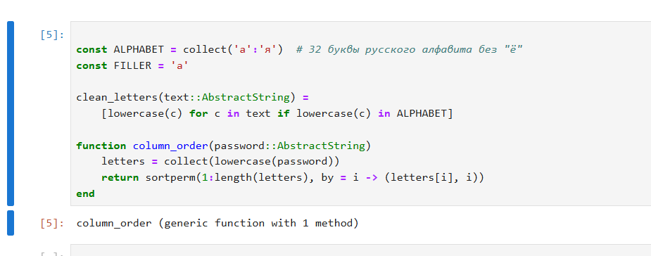
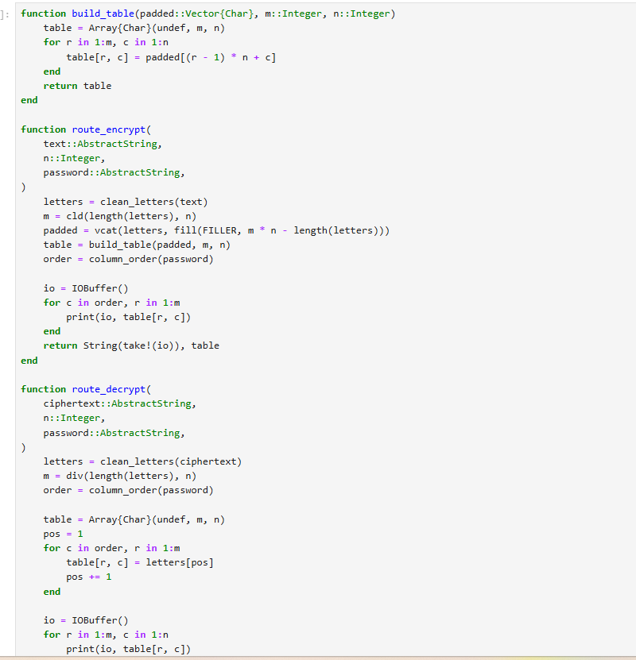
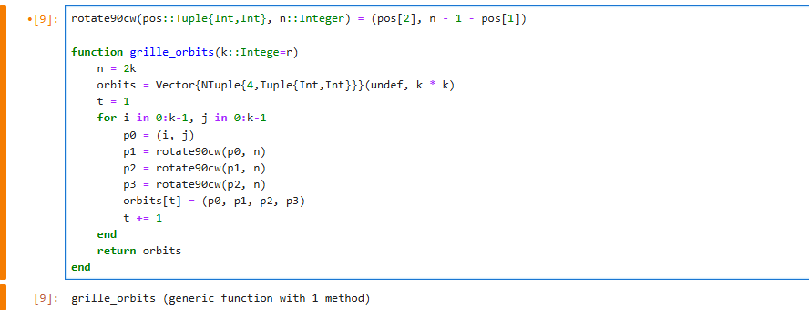
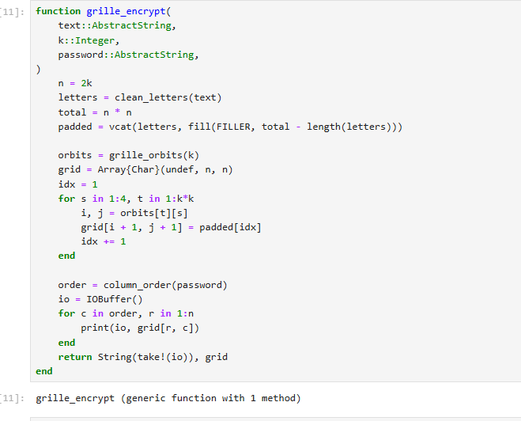
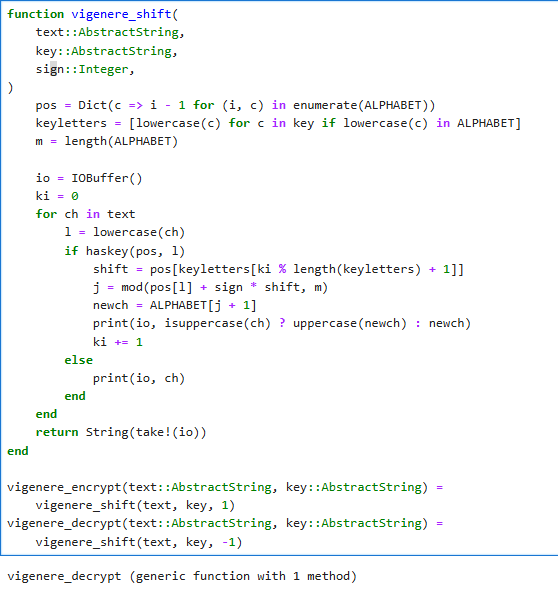

---
## Front matter
lang: ru-RU
title: Лабораторная работа № 2
subtitle: "Шифры перестановки: маршрутное шифрование, решётка Флейснера и шифр Виженера"
author:
  - Шуваев С. А.
institute:
  - Российский университет дружбы народов, Москва, Россия

## i18n babel
babel-lang: russian
babel-otherlangs: english

## Formatting pdf
toc: false
toc-title: Содержание
slide_level: 2
aspectratio: 169
section-titles: true
theme: metropolis
header-includes:
 - \metroset{progressbar=frametitle,sectionpage=progressbar,numbering=fraction}
---

# Информация

## Докладчик

:::::::::::::: {.columns align=center}
::: {.column width="70%"}

  * Шуваев Сергей Александрович
  * студент
  * Российский университет дружбы народов
  * [1032262691@rudn.ru](mailto:1032262691@pfur.ru)
  * <https://Grinders060050.github.io/ru/>

:::
::: {.column width="25%"}

:::
::::::::::::::

## Цель работы

- Изучить и реализовать на языке Julia шифры перестановки:
- Маршрутное (столбцовое) шифрование
- Решётка Флейснера
- Шифр Виженера

## Задание

- Кратко представиться.
- Сформулировать цель одним предложением: три шифра перестановки, один язык реализации.

# Выполнение лабораторной работы

## Идея и общая функция

{#fig:001 width=55%}

## Шифрование и расшифрование

{#fig:002 width=70%}

# Решётка Флейснера

{#fig:003 width=70%}

## Построение орбит и заполнение

{#fig:004 width=60%}

# Шифр Виженера

{#fig:005 width=70%}

## Выводы

- Реализованы три шифра перестановки на Julia: маршрутное шифрование, решётка Флейснера, шифр Виженера
- Маршрутное шифрование и решётка Флейснера сведены к общей операции -- чтению/заполнению таблицы по столбцам через пароль (`column_order`)
- Решётка Флейснера добавляет один промежуточный шаг -- заполнение большого квадрата через орбиты поворота на $90^\circ$
- Шифр Виженера -- параметризованное паролем обобщение шифра Цезаря

