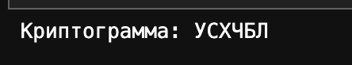

---
## Front matter
lang: ru-RU
title: Лабораторная работа № 3
subtitle: Шифрование гаммированием
author:
  - Шуваев С. А.
institute:
  - Российский университет дружбы народов, Москва, Россия

## i18n babel
babel-lang: russian
babel-otherlangs: english

## Formatting pdf
toc: false
toc-title: Содержание
slide_level: 2
aspectratio: 169
section-titles: true
theme: metropolis
header-includes:
 - \metroset{progressbar=frametitle,sectionpage=progressbar,numbering=fraction}
---

# Информация

## Докладчик

:::::::::::::: {.columns align=center}
::: {.column width="70%"}

  * Шуваев Сергей Александрович
  * студент
  * Российский университет дружбы народов
  * [1032262691@pfur.ru](mailto:1032262691@pfur.ru)
  * <https://Grinders060050.github.io/ru/>

:::
::: {.column width="25%"}


:::
::::::::::::::

## Цель работы

Изучить и реализовать шифр гаммированием.

## Задание

Реализовать с помощью языка программирования Julia алгоритм шифрования гаммированием конечной гаммой.

## Выполнение лабораторной работы

```Julia
function gamma_encryption(word, key)
    encrypted = ""
    word_chars = collect(word)
    key_chars = collect(key)
    for (i,j) in enumerate(word)
        c = (Int(j) - Int('А') + \\
          Int(key_chars[(i - 1) % length(key) + 1]) \\
            - Int('А') + 1) % 32 + Int('А')
        encrypted *= Char(c)
    end
    return encrypted
end
```
## Выполнение лабораторной работы

```Julia
word = "ПРИКАЗ"
key = "ГАММА"
res = gamma_encryption(word,key)
print(res)
```

## Выполнение лабораторной работы

{#fig-001 width=70%}

## Выводы

В результате выполнения данной лабораторной работы был изучен и реализован алгоритм шифрования гаммированием конечной гаммой.

## Список литературы

1. Julia1.11Documentation. url: https://docs.julialang.org/en/v1/ (дата обр. 11.10.2024)

2. JuliaLang. url: https://julialang.org/ (дата обр. 11.10.2024)