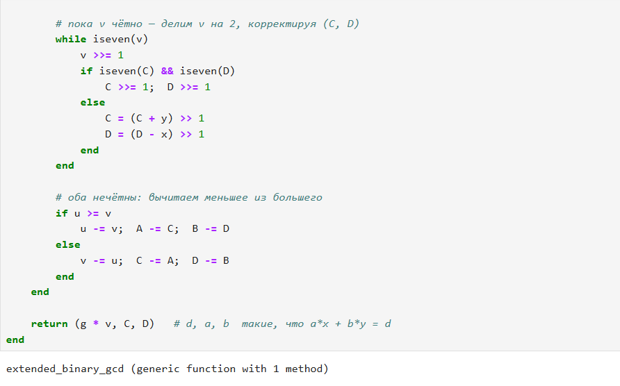

---
## Front matter
lang: ru-RU
title: Лабораторная работа № 4
subtitle: Вычисление наибольшего общего делителя
author:
  - Шуваев С. А.
institute:
  - Российский университет дружбы народов, Москва, Россия

## i18n babel
babel-lang: russian
babel-otherlangs: english

## Formatting pdf
toc: false
toc-title: Содержание
slide_level: 2
aspectratio: 169
section-titles: true
theme: metropolis
header-includes:
 - \metroset{progressbar=frametitle,sectionpage=progressbar,numbering=fraction}
---

# Информация

## Докладчик

:::::::::::::: {.columns align=center}
::: {.column width="70%"}

  * Шуваев Сергей Александрович
  * студент
  * Российский университет дружбы народов
  * [1032262691@pfur.ru](mailto:1032262691@pfur.ru)
  * <https://Grinders060050.github.io/ru/>

:::
::: {.column width="25%"}

:::
::::::::::::::

## Цель работы

Реализовать все рассмотренные алгоритмы программно.

## Задание

1. Алгоритм Евклида.
2. Бинарный алгоритм Евклида.
3. Расширенный алгоритм Евклида.
4. Расширенный бинарный алгоритм Евклида.

# Выполнение лабораторной работы

{#fig:001 width=70%}

## Выполнение лабораторной работы

{#fig:002 width=70%}

## Выполнение лабораторной работы

{#fig:003 width=55%}

## Выполнение лабораторной работы

{#fig:004 width=55%}

{#fig:005 width=55%}

## Выводы

В результате выполнения данной лабораторной работы я программно на практике реализовал 4 Евклидова Алгоритма в среде Julia.

## Список литературы

::: {#refs}
:::

