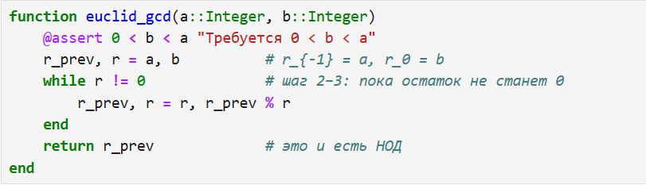
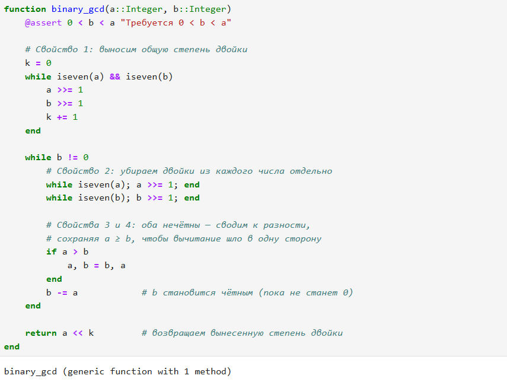
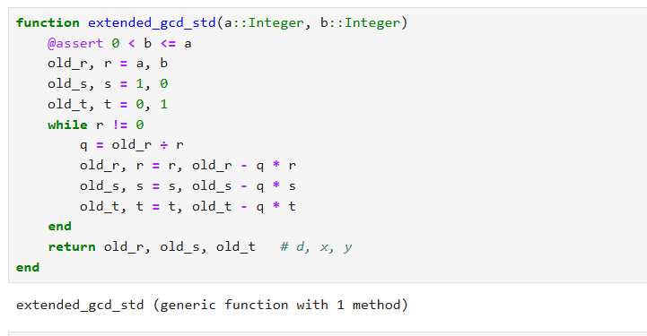
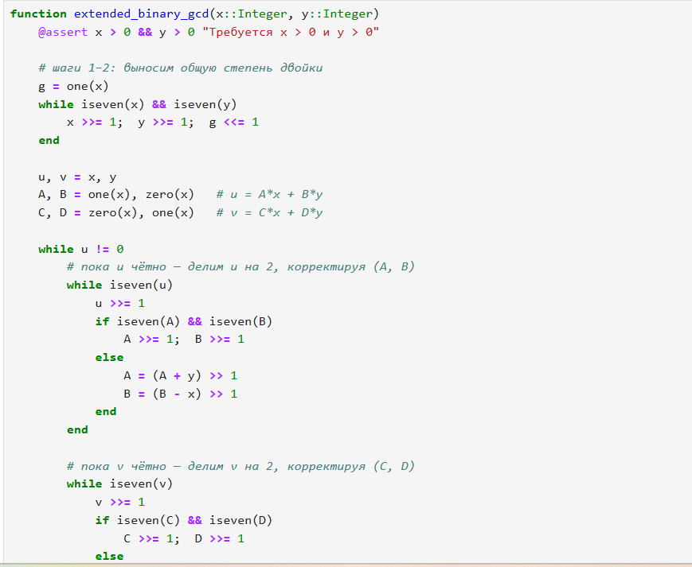

---
## Front matter
title: "Лабораторная работа № 4"
subtitle: "Вычисление наибольшего общего делителя"
author: "Шуваев Сергей Александрович"

## Generic otions
lang: ru-RU
toc-title: "Содержание"

## Bibliography
bibliography: bib/cite.bib
csl: pandoc/csl/gost-r-7-0-5-2008-numeric.csl

## Pdf output format
toc: true # Table of contents
toc-depth: 2
lof: true # List of figures
lot: false # List of tables
fontsize: 12pt
linestretch: 1.5
papersize: a4
documentclass: scrreprt
## I18n polyglossia
polyglossia-lang:
  name: russian
  options:
	- spelling=modern
	- babelshorthands=true
polyglossia-otherlangs:
  name: english
## I18n babel
babel-lang: russian
babel-otherlangs: english
## Fonts
mainfont: IBM Plex Serif
romanfont: IBM Plex Serif
sansfont: IBM Plex Sans
monofont: IBM Plex Mono
mathfont: STIX Two Math
mainfontoptions: Ligatures=Common,Ligatures=TeX,Scale=0.94
romanfontoptions: Ligatures=Common,Ligatures=TeX,Scale=0.94
sansfontoptions: Ligatures=Common,Ligatures=TeX,Scale=MatchLowercase,Scale=0.94
monofontoptions: Scale=MatchLowercase,Scale=0.94,FakeStretch=0.9
mathfontoptions:
## Biblatex
biblatex: true
biblio-style: "gost-numeric"
biblatexoptions:
  - parentracker=true
  - backend=biber
  - hyperref=auto
  - language=auto
  - autolang=other*
  - citestyle=gost-numeric
## Pandoc-crossref LaTeX customization
figureTitle: "Рис."
tableTitle: "Таблица"
listingTitle: "Листинг"
lofTitle: "Список иллюстраций"
lotTitle: "Список таблиц"
lolTitle: "Листинги"
## Misc options
indent: true
header-includes:
  - \usepackage{indentfirst}
  - \usepackage{float} # keep figures where there are in the text
  - \floatplacement{figure}{H} # keep figures where there are in the text
---

# Цель работы

Реализовать все рассмотренные алгоритмы программно.

# Задание

1. Алгоритм Евклида.
2. Бинарный алгоритм Евклида.
3. Расширенный алгоритм Евклида.
4. Расширенный бинарный алгоритм Евклида.

# Теоретическое введение

Julia — это высокоуровневый, высокопроизводительный динамический язык программирования с открытым исходным кодом, специально созданный для научных и численных вычислений, а также для решения задач машинного обучения и анализа данных.

Его главная особенность — способность сочетать простоту и выразительность динамических языков (таких как Python и R) со скоростью компилируемых языков (таких как C и C++)

# Выполнение лабораторной работы

function euclid_gcd(a::Integer, b::Integer)
    @assert 0 < b < a "Требуется 0 < b < a"
    r_prev, r = a, b          # r_{-1} = a, r_0 = b
    while r != 0              # шаг 2–3: пока остаток не станет 0
        r_prev, r = r, r_prev % r
    end
    return r_prev             # это и есть НОД
end

euclid_gcd (generic function with 1 method)

{#fig:001 width=70%}

function binary_gcd(a::Integer, b::Integer)
    @assert 0 < b < a "Требуется 0 < b < a"

    # Свойство 1: выносим общую степень двойки
    k = 0
    while iseven(a) && iseven(b)
        a >>= 1
        b >>= 1
        k += 1
    end

    while b != 0
        # Свойство 2: убираем двойки из каждого числа отдельно
        while iseven(a); a >>= 1; end
        while iseven(b); b >>= 1; end

        # Свойства 3 и 4: оба нечётны — сводим к разности,
        # сохраняя a ≥ b, чтобы вычитание шло в одну сторону
        if a > b
            a, b = b, a
        end
        b -= a            # b становится чётным (пока не станет 0)
    end

    return a << k         # возвращаем вынесенную степень двойки
end

binary_gcd (generic function with 1 method)

{#fig:002 width=70%}

function extended_gcd_std(a::Integer, b::Integer)
    @assert 0 < b <= a
    old_r, r = a, b
    old_s, s = 1, 0
    old_t, t = 0, 1
    while r != 0
        q = old_r ÷ r
        old_r, r = r, old_r - q * r
        old_s, s = s, old_s - q * s
        old_t, t = t, old_t - q * t
    end
    return old_r, old_s, old_t   # d, x, y
end

extended_gcd_std (generic function with 1 method)

{#fig:003 width=70%}

function extended_binary_gcd(x::Integer, y::Integer)
    @assert x > 0 && y > 0 "Требуется x > 0 и y > 0"

    # шаги 1–2: выносим общую степень двойки
    g = one(x)
    while iseven(x) && iseven(y)
        x >>= 1;  y >>= 1;  g <<= 1
    end

    u, v = x, y
    A, B = one(x), zero(x)   # u = A*x + B*y
    C, D = zero(x), one(x)   # v = C*x + D*y

    while u != 0
        # пока u чётно — делим u на 2, корректируя (A, B)
        while iseven(u)
            u >>= 1
            if iseven(A) && iseven(B)
                A >>= 1;  B >>= 1
            else
                A = (A + y) >> 1
                B = (B - x) >> 1
            end
        end

        # пока v чётно — делим v на 2, корректируя (C, D)
        while iseven(v)
            v >>= 1
            if iseven(C) && iseven(D)
                C >>= 1;  D >>= 1
            else
                C = (C + y) >> 1
                D = (D - x) >> 1
            end
        end

        # оба нечётны: вычитаем меньшее из большего
        if u >= v
            u -= v;  A -= C;  B -= D
        else
            v -= u;  C -= A;  D -= B
        end
    end

    return (g * v, C, D)   # d, a, b  такие, что a*x + b*y = d
end

extended_binary_gcd (generic function with 1 method)

{#fig:004 width=70%}

{#fig:005 width=70%}

# Выводы

В результате выполнения данной лабораторной работы я программно на практике реализовал 4 Евклидова Алгоритма в среде Julia.

# Список литературы{.unnumbered}

::: {#refs}
:::
